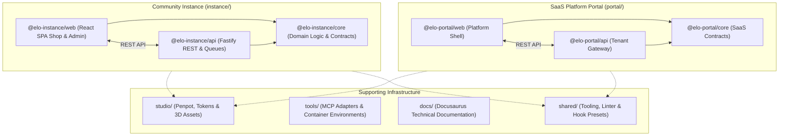

# Elo Orgânico Platform (`@devtupynambalucas/elo-organico`)

Specialized management platform for organic product sharing cycles, community marketplace logistics, and decentralized food distribution monorepo (`tupynambalucas-dev/elo-organico`) delivering standalone community shops with future-ready SaaS tenant orchestration.

---

## 1. Architecture Overview

`elo-organico` operates under a **Context-Driven Root** architecture isolating community instances, global SaaS foundations, creative assets, automation tools, and documentation:



```text
elo-organico/
├── .agents/                 # AI agent personas, tools, and local skills
├── docs/                    # Technical and architectural documentation hub (Docusaurus)
├── instance/                # Community shop bounded context (core, api, web)
│   ├── packages/core/       # Domain contracts, Zod schemas, and business models
│   └── services/            # Fastify API (api) and React SPA (web)
├── portal/                  # Multi-tenant platform portal context (core, api, web)
│   ├── packages/core/       # SaaS orchestration schemas
│   └── services/            # Platform API and Web shell
├── shared/                  # Monorepo-wide configs, Git hooks, and presets
├── studio/                  # Visual identity tokens, icons, and Penpot services
├── tools/                   # MCP gateway, Docker automation, and agent runtimes
├── AGENTS.md                # Layer 1 context router for AI agents
├── CHANGELOG.md             # Automated release and package changelog
├── LICENSE.md               # Repository license terms
├── package.json             # Root monorepo manifest and pipeline scripts
├── pnpm-workspace.yaml      # Strict pnpm workspace catalog definitions
└── turbo.json               # Turborepo task pipeline orchestration
```

---

## 2. Bounded Contexts & Navigation

| Context / Subsystem    | Path        | Documentation                                | Agent Context                                | Purpose / Responsibilities                                                           |
| :--------------------- | :---------- | :------------------------------------------- | :------------------------------------------- | :----------------------------------------------------------------------------------- |
| **Community Instance** | `instance/` | [`instance/README.md`](./instance/README.md) | [`instance/AGENTS.md`](./instance/AGENTS.md) | Single-instance mastery: Community store, admin panel, Fastify API, BullMQ queues.   |
| **Platform Portal**    | `portal/`   | [`portal/README.md`](./portal/README.md)     | [`portal/AGENTS.md`](./portal/AGENTS.md)     | Multi-tenant SaaS orchestration, platform landing page, global tenant gateway.       |
| **Studio & Design**    | `studio/`   | [`studio/README.md`](./studio/README.md)     | [`studio/AGENTS.md`](./studio/AGENTS.md)     | Brand tokens, SVG icons, self-hosted Penpot services, and 3D assets.                 |
| **Tools & Automation** | `tools/`    | [`tools/README.md`](./tools/README.md)       | [`tools/AGENTS.md`](./tools/AGENTS.md)       | Local MCP server adapters, Docker tooling, containerized agent runtime environments. |
| **Documentation Hub**  | `docs/`     | [`docs/README.md`](./docs/README.md)         | _(inherits root)_                            | Docusaurus technical documentation portal (Handbook, Architecture, and Roadmaps).    |
| **Shared Tooling**     | `shared/`   | [`shared/README.md`](./shared/README.md)     | _(inherits root)_                            | Shared ESLint configurations, Prettier settings, and Git lifecycle hooks.            |

---

## 3. Environment & Secret Governance

All runtime secrets and service connections resolve via **Infisical** or local `.env` templates excluded from version control:

| Variable Name               | Target Workspace        | Purpose                                                          |
| :-------------------------- | :---------------------- | :--------------------------------------------------------------- |
| `NODE_ENV` / `PORT`         | `instance/services/api` | Runtime mode (`development` / `production`) and HTTP port.       |
| `MONGO_URI`                 | `instance/services/api` | MongoDB replica set connection string for instance database.     |
| `REDIS_HOST` / `REDIS_PORT` | `instance/services/api` | Redis connection for caching and BullMQ background task workers. |
| `JWT_SECRET`                | `instance/services/api` | Cryptographic secret for signing auth session tokens.            |
| `PENPOT_SECRET_KEY`         | `studio/penpot`         | Security key for the self-hosted Penpot design container stack.  |

---

## 4. Getting Started

### Prerequisites

- **Node.js**: `>= 22.x`
- **pnpm**: `11.1.2` (enforced via strict catalog in [`pnpm-workspace.yaml`](./pnpm-workspace.yaml))
- **Docker Compose**: Required for running local MongoDB, Redis, and Penpot stacks.

### Installation & Local Startup

```bash
# 1. Clone the repository (or sync via org-ecosystem Mani manifest)
git clone git@github.com:tupynambalucas-dev/elo-organico.git
cd elo-organico

# 2. Install workspace dependencies from strict pnpm catalogs
pnpm install

# 3. Start the Community Instance stack (Docker infra + API + Web)
pnpm instance:dev

# 4. Or start the Technical Documentation Hub (http://localhost:3000)
pnpm docs:dev
```

---

## 5. Development & Pipeline Scripts

| Command              | Target Scope    | Description                                                            |
| :------------------- | :-------------- | :--------------------------------------------------------------------- |
| `pnpm dev`           | Monorepo        | Runs development tasks across all active workspaces via Turborepo.     |
| `pnpm build`         | Monorepo        | Compiles all packages and applications for production.                 |
| `pnpm lint`          | Monorepo        | Executes ESLint verification across all packages.                      |
| `pnpm typecheck`     | Monorepo        | Runs TypeScript solution typecheck across all workspaces.              |
| `pnpm instance:dev`  | `instance/*`    | Boots community infrastructure and launches API and Web in watch mode. |
| `pnpm instance:up`   | `instance/*`    | Starts local MongoDB and Redis Docker containers.                      |
| `pnpm instance:down` | `instance/*`    | Stops local community Docker containers and frees ports.               |
| `pnpm portal:dev`    | `portal/*`      | Boots platform portal infrastructure and applications in watch mode.   |
| `pnpm docs:dev`      | `docs/`         | Starts local Docusaurus documentation portal.                          |
| `pnpm docs:build`    | `docs/`         | Compiles production Docusaurus documentation bundle.                   |
| `pnpm penpot:up`     | `studio/penpot` | Starts self-hosted Penpot design studio container stack.               |

---

## 6. Governance & Contributing Standards

All development across `elo-organico` must strictly comply with organizational governance:

1. **Cryptographic Commit Signing**: All Git commits and annotated tags MUST be signed using SSH (`git commit -S -m "..."`).
2. **Conventional Commits**: Commit messages must follow Conventional Commits v1.0.0 (`<type>(<scope>): <description>`).
3. **Single-Branch GitHub Flow**: Features and fixes branch off `main` using standard prefixes (`feat/<slug>`, `fix/<slug>`, `docs/<slug>`, `chore/<slug>`) and merge via Pull Request.
4. **Zero-Emoji Invariant**: Emojis are strictly prohibited in code, commits, PRs, comments, and documentation.
5. **Secret Hygiene**: Never commit plaintext tokens or `.env` files; all secrets resolve via Infisical.
6. **AI Agent Context**: Autonomous agents operating in this monorepo MUST read [AGENTS.md](./AGENTS.md) before making modifications.

---

## 7. License

Licensed under [CC-BY-NC-4.0](./LICENSE.md). Copyright (c) 2026 devtupynambalucas.
